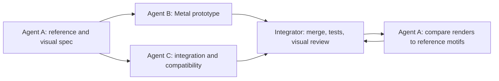

# Worldline 2: implementation plan

## Goal and scope

Add **Worldline 2** as a fourth transition choice in the settings panel. Selecting
it and then clicking **Glass/Original** will play a new effect between the two
halves of the existing stacked wallpaper video. Keep the current **World-line**
transition (style 2) unchanged. Worldline 2 is a transition, not a replacement
wallpaper loop; its source and destination must still be the current video frames.

Status: style 3 is implemented in the app, added to the settings cycle, and
built into the installed app bundle. The user's wallpaper media and
LaunchAgent definition were not changed. The screenshot-based demo is a local
preview; the shipping effect is generated by the Metal shader.

**Visual revision from the user's seven screenshots:** the dominant image is
white paper with dense, fine black mathematical construction. Circles, nested
arcs, tangents, graph paths, axes, angle marks, tick scales, triangles,
rectangles, nodes, and small symbols overlap at many sizes. The camera pans,
tilts, and pushes through independent depth layers; the linework crowds into
a dark, softly blurred convergence before clearing and streaking into the next
world. The camera must translate through real perspective depth, with a
changing viewing angle and field of view. Scaling a flat diagram texture does
not meet this requirement. This takes priority over the earlier blue
clock-centered concept.

## What the supplied MP4 shows

Reference: the user's local 89.98-second, 1920 × 1080, 23.976 fps MP4 in
`~/Downloads/` (the *Hacking to the Gate* opening). These observations are
visual references, not a request to copy footage or artwork into the app.

| MP4 time | Visual cue | Worldline 2 translation |
|---|---|---|
| 0–3 s | Sparse dark fragments assemble on white | A few small shards that draw toward the focal point |
| 4–11 s | Fine clock/circuit circles and crosshairs accumulate, then converge into a dark knot | Layered technical rings, radial spokes, and inward motion |
| 15–20 s | Large gear shadows frame pale empty space | Low-opacity gear/tooth silhouettes at the edges |
| ~37 s | A bright circular disc interrupts dark clockwork | Short, bounded central light pulse |
| ~49 s | Several translucent clock faces overlap | Rings at different scales and angular speeds, with sparse Roman markers |
| ~59 s | Ghosted numerals hover over near-black | Faint existing divergence digits, offset in depth |
| 69–81 s | Blue/violet streaks, vertical light columns, prismatic facets | Brief cool chromatic split, scan columns, and a few refractive wedges |
| 85–89 s | Grainy light field with gear shadows | Fine grain and a clean release to the destination frame |

Use the shot language and timing relationships, not the exact composition,
characters, title cards, typography, or frames. The user's video stays local.

## 3.3-second transition

Time below is normalized progress `p`; easing functions should overlap rather
than make hard cuts. The same animation must work Original → Glass and Glass →
Original.

| Progress | Visual and source behavior |
|---|---|
| 0.00–0.04 | Begin on the exact source frame. The entry starts immediately. |
| 0.03–0.10 | The source image breaks into irregular geometric cells and disappears in a few frames, exposing a corridor of diagrams. Brief horizontal glitches and RGB separation punctuate the break. |
| 0.08–0.70 | Drive the camera forward through 3D-placed circles, axes, graph paths, triangles, nodes, arcs, and small mathematical marks. Nearby objects cross the screen quickly; distant ones move slowly. Bank and yaw the camera and vary focal length so depth and viewing angle both change. Increase motion blur with camera speed. |
| 0.55–0.78 | Pass through a dense cluster, then arc into a lighter part of the corridor. Keep foreground marks sharper/darker than distant marks. |
| 0.77–0.92 | Diagram objects disappear in a staggered geometric pattern while the destination frame reconstructs through fractured cells. Add short horizontal glitches, a few vertical streaks, and restrained blue/violet channel separation. |
| 0.90–1.00 | Clear all geometry, blur, and streaks. End on the exact destination frame. |

Keep the entry fast but avoid a single-frame white flash; honor Low Power Mode's existing
30 fps cap. The name, settings gear, clock,
lyrics, and music glow remain separate live overlays as they are now.

## Architecture and implementation decisions

1. Append `worldLine2 = 3` to `TransitionStyle` in
   `Sources/TransitionRenderer.swift`. Keep raw values 0–2 and the existing
   `transitionStyle` UserDefaults key. Add display name, short tile label, and
   cycle order. Add `WORLD_LINE_2_DURATION` in `Sources/Style.swift`.
2. Add a separate `worldLine2(...)` shader function and `style == 3` dispatch in
   `Sources/Transition.metal`. Leave `worldLineShift(...)` and style 2 dispatch
   untouched. Reuse `sampleSource`, `coverUV`, the clock math, hash noise, and
   the existing digit atlas where useful. No wallpaper re-encode is required.
3. The implemented Metal path samples eight procedural diagram planes at
   distinct depths. A moving and banking camera projects rays through each
   plane, giving changing scale and parallax from perspective without extra
   textures or uniforms. The math includes circles, arcs, graph plots, axes,
   triangles, scales, and calibration marks. The source and destination break
   into geometric cells at the two handoffs, with short glitch accents rather
   than a sliding background wipe or long fade. An instanced geometry pass
   remains an option only if profiling shows the fragment path is too costly
   or further visual complexity is needed.
4. Keep the current 160-byte Swift/Metal uniform layout if possible. Derive all
   phases from existing `progress`, `time`, `viewSize`, `fromSource`, `toSource`,
   and digit fields. If extra fields become necessary, update both structs,
   the stride check, and shader reflection together.
5. The config-dir shader takes precedence over the bundled shader. Build both
   pipelines when a user shader is present: use the user pipeline for styles
   0–2, and use it for style 3 only when it declares Worldline 2 support;
   otherwise use the bundled pipeline for style 3 and log that choice. Keep
   the user shader file intact. Define support with a deliberate marker or
   function lookup, not an accidental text match. If either pipeline fails to
   compile, retain the existing bundled fallback behavior. Test this with an
   old but valid config shader and with an edited Worldline 2 shader.
6. Update `README.md` and `AGENTS.md` only after the visual implementation is
   settled, including the selection path and the shader copy behavior.

## Connected subagent work packages

Use **three specialists plus one integrator**. The arrows are handoff gates:
each receiver gets the predecessor's artifact and acceptance notes. The
integrator owns final merges and user-visible verification. Agents should work
in separate branches/worktrees or have exclusive file ownership; do not edit
the current unrelated lyrics changes.

| Owner | Tasks and owned output | Depends on | Done when |
|---|---|---|---|
| Agent A: visual spec | Use the seven supplied screenshots and MP4 to annotate geometry types, line weights, density, blur, and camera direction; define acceptance stills at `p=0, .25, .50, .75, 1`. Share a phase sheet with B and C. | Supplied reference and this plan | The phase sheet prioritizes white mathematical geometry and a moving camera, without copying anime frames. |
| Agent B: diagram and Metal effect | Generate the original 3D line scene; implement perspective camera movement, depth cues, speed-linked motion blur, geometric breakup/reconstruction, and brief glitch accents. Own the diagram generator and style 3 shader work. | A's phase spec | Shader compiles; near/far parallax and camera angle changes are visible; no entry/exit slide remains; style 2 remains unchanged. |
| Agent C: app integration | Add enum/cycle/names/duration; implement dual-pipeline compatibility for old user shaders; update settings and shader selection tests; document how to select Worldline 2. Own `TransitionRenderer.swift`, `Style.swift`, focused tests, and docs outside the shader. | A's phase spec and B's declared shader entry/marker contract | Style 3 persists and cycles; an old config shader cannot silently show a crossfade; styles 0–2 retain raw values and behavior. |
| Integrator | Combine B and C; resolve the shader contract; run tests/build/offscreen render; review at two screen aspect ratios, two transition directions, Low Power Mode, and a valid old user shader; fix findings and finish docs. | B and C complete | Acceptance gates below pass; no existing personal media or config file is copied into the repository. |

Detailed split inside the packages:

1. **Reference extraction (A):** choose 6–10 noncontiguous reference moments;
   record motion, density, palette, and what should *not* be literal; hand off
   one phase sheet to B and one UI expectation to C.
2. **Core geometry (B):** author deterministic 3D fields of circles, arcs,
   tangents, graph connections, angle marks, scales, axes, polygons, nodes,
   and small mathematical symbols at varied depths and plane tilts. Tune line
   thickness at 16:9 and 16:10.
3. **Camera motion (B):** animate physical forward/lateral camera translation,
   yaw, pitch, roll, and focal length. Verify near objects visibly pass the
   viewer while distant ones drift. Increase motion blur with speed and ease
   all camera values continuously under variable frame timing.
4. **World reveal (B):** blend from the actual source half to the actual target
   half after the white diagram passage with geometric reconstruction, including
   clamping so stacked video halves never bleed into each other.
5. **Accent layers (B):** add a dark converging cluster of fine marks, then
   short horizontal glitches, displaced blocks, vertical streaks, and
   restrained blue/violet channel separation at the two handoffs. Let some
   geometric marks vanish independently near the exit. Keep the main passage
   predominantly monochrome.
6. **Selection and state (C):** append style 3, duration, tile label, cycling,
   and persistence coverage; preserve the default style and existing saved
   choices.
7. **Shader compatibility (C):** test with no config shader, a current custom
   shader, a valid pre-Worldline-2 shader, and a broken config shader. State in
   the log which pipeline supplies style 3.
8. **Integration and QA (integrator):** run the project tests and Swift build,
   compile Metal, render phase stills offscreen, compare endpoints against
   straight source/destination frames, and check GPU frame time and memory.
9. **Reference review (A → integrator):** compare the offscreen stills to the
   timestamped motif sheet; request only focused changes to timing, contrast,
   and composition.

## Resources and rights

No external downloads are needed for the recommended effect. The project
instructions forbid downloading wallpaper/artwork, and the current code already
generates the digit atlas locally. The new mathematical line geometry can
be generated from original code and drawn with Metal. The supplied MP4 is a local visual reference only. Do
not commit it, extracted frames, title graphics, characters, credits, or music.
If a future implementation needs a third-party code or font resource, record
its URL, license, and attribution before adding it; do not source anime art.

## Verification and release gates

- **Behavior:** Settings cycles through Fade → Storm → World-line → Worldline 2
  → Fade; clicking Glass/Original plays style 3 in either direction; saved raw
  values 0–2 still map to their old styles.
- **Frames:** at `p=0`, style 3 equals the original source sample; at `p=1`,
  it equals the target sample. No seam, black frame, spill between stacked
  halves, or lingering diagram/streak layer after completion. Check
  `p=.25/.50/.75` against the phase sheet on a bright and a dark wallpaper frame;
  near/far parallax, camera banking, and focal-length change must be visible
  when played at speed. Reject a result that looks like a resized flat image.
- **Performance:** target 60 fps during the transition on the development Mac,
  30 fps in Low Power Mode, no sustained renderer frame over the relevant
  frame budget (16.7/33.3 ms) in a captured sample. Compare GPU time and memory
  against current World-line; simplify geometry if the new effect regresses
  materially. Idle resolution/FPS and covered-screen pause behavior must remain
  unchanged.
- **Compatibility:** test bundled shader, updated custom shader, older valid
  custom shader, and broken custom shader. The older shader must leave the
  user's original custom styles usable while bundled style 3 renders.
- **Checks:** `scripts/run-tests.sh`, `scripts/build.sh`, Metal syntax compile,
  and the documented offscreen Metal render harness. After implementation,
  perform one on-screen visual check with the user; do not change their desktop
  picture or LaunchAgent as part of this plan.

Implementation should not touch the existing unrelated modifications in
`Sources/LyricsProvider.swift`, `Tests/LyricsProviderTests/main.swift`, or
`Tests/MusicSessionTests/main.swift`.
